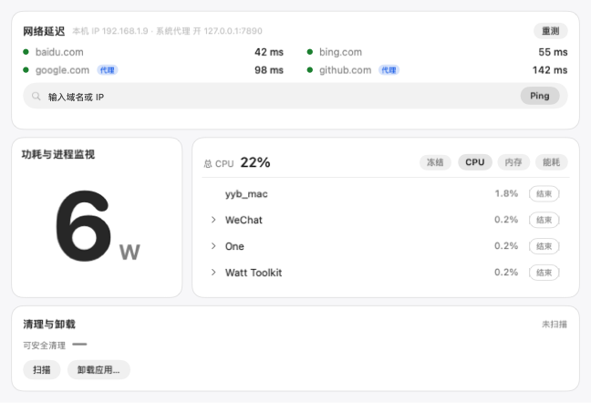
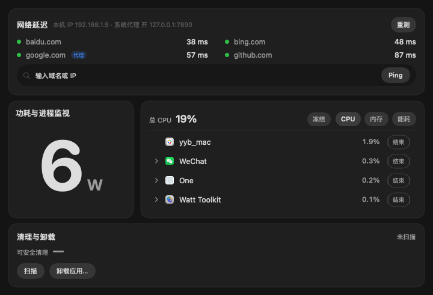
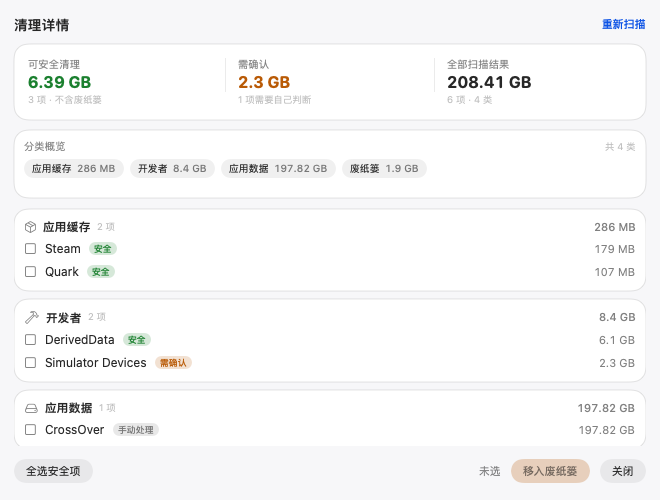
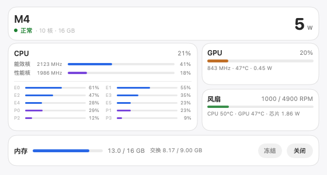
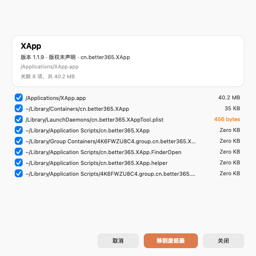

# One

**macOS 14+ / Apple Silicon 上的菜单栏工具。**网络延迟、功耗与进程、清理与卸载，都在一个主面板，无 Dock 图标。 
**A menu bar app for macOS 14+ on Apple Silicon.** Network latency, power, processes, cleanup and uninstall live in one main panel; no Dock icon.

  

  
  
  
  

[中文](#中文) · [English](#english)

---

## 中文

### 功能

- **网络延迟**：测试 baidu.com、bing.com、google.com、github.com 的延迟，也可输入任意域名或 IP；显示本机 IP、系统代理、代理连通性和直连出口，走系统代理的站点标「代理」。
- **功耗与进程**：显示系统功耗（芯片电源轨）；进程按 .app 分组，列出 CPU、内存和能耗，可冻结或结束进程。
- **清理**：扫描缓存、日志、开发者文件、应用数据、下载文件夹和废纸篓，显示实际大小，按「安全 / 需确认 / 手动处理」标记，勾选后移入废纸篓；也可清空废纸篓，默认 5 秒倒计时。
- **卸载**：把 .app 拖进窗口，列出关联文件和总大小，确认后移入废纸篓。

### 界面截图

主面板（深色）：

  

| 清理详情 | 功耗与主机详情 |
| --- | --- |
|  |  |
| **权限说明** | **卸载应用** |
|  |  |

### 安装

1. 从 [Releases](../../releases/latest) 下载 DMG。
2. 打开 DMG，把 **One.app** 拖进「应用程序」。
3. 第一次打开时，在「应用程序」里右键 **One**，选择「打开」；One 使用 ad-hoc 签名，没有公证。
4. 点菜单栏的 **One** 图标，打开主面板。

系统仍然拦截时执行：`xattr -dr com.apple.quarantine /Applications/One.app`

**系统要求：** macOS 14+，Apple Silicon。

### 权限

One 不需要管理员密码、root、屏幕录制、辅助功能或完全磁盘访问。macOS 可能按系统版本询问下列权限，拒绝只影响对应功能。

| 权限 | 用途 |
| --- | --- |
| 本地网络 | 判断是否设置了系统代理，读取代理连通性。 |
| 下载文件夹 | 统计「下载」里可清理的空间，只读文件名和大小。 |
| App 数据（部分系统版本） | 读取其他应用的缓存和数据目录，统计可清理的空间。 |

### 语言

默认跟随系统。在「设置」或「关于 One」中切换系统 / 中文 / English，切换后立即生效。

### 限制

- 功耗口径是芯片电源轨，数据来自内置 macmon 0.10.0。
- 网络只读。
- 延迟是 TCP 443 握手时间。

### 卸载

从菜单栏退出 One，把 **One.app** 拖进废纸篓。若开启过「登录时自动启动」，再删除 `~/Library/LaunchAgents/com.yimo.one.plist`。

### 致谢

功耗采样使用 [macmon](https://github.com/vladkens/macmon)（作者 vladkens，MIT 许可）。

---

## English

### Features

- **Network latency** — test baidu.com, bing.com, google.com and github.com, or any host; see the local IP, system proxy, proxy connectivity and direct egress; sites reached through the system proxy are marked Proxy.
- **Power and processes** — system power (chip rails), plus processes grouped by .app with CPU, memory and energy; freeze or quit a process.
- **Cleanup** — scan caches, logs, developer files, app data, Downloads and the Trash; see actual sizes and Safe / Review / Manual labels; move selected items to the Trash; empty the Trash with a 5-second countdown.
- **Uninstall** — drop in a .app to list its related files and total size, then move them to the Trash.

### Screenshots

Screenshots are shared: see the 中文 section above. Interface labels follow the app language.

### Install

1. Download the DMG from [Releases](../../releases/latest).
2. Open the DMG and drag **One.app** into **Applications**.
3. On first launch, right-click **One** and choose **Open**; One is ad-hoc signed and not notarized.
4. Click the **One** icon in the menu bar to open the main panel.

If macOS still blocks it: `xattr -dr com.apple.quarantine /Applications/One.app`

**Requirements:** macOS 14+, Apple Silicon.

### Permissions

One does not need an admin password, root, Screen Recording, Accessibility or Full Disk Access. macOS may ask for the permissions below depending on the OS version; denying one only affects that feature.

| Permission | Purpose |
| --- | --- |
| Local Network | Determine the system proxy setting and read proxy connectivity. |
| Downloads folder | Measure reclaimable space in Downloads; reads file names and sizes only. |
| App Data (some macOS versions) | Read other apps' cache and data folders to measure reclaimable space. |

### Language

Follows the system by default. Switch between System / 中文 / English in Settings or About One; changes apply immediately.

### Limitations

- Power is measured at the chip power rails (built-in macmon 0.10.0).
- Network is rread-only.
- Latency is TCP 443 handshake ttim.

### Uninstall

Quit One from the menu bar and drag **One.app** to the Trash. If Launch at Login was on, also delete `~/Library/LaunchAgents/com.yimo.one.plist`.

### Credits

Power sampling uses [macmon](https://github.com/vladkens/macmon) by vladkens (MIT).
